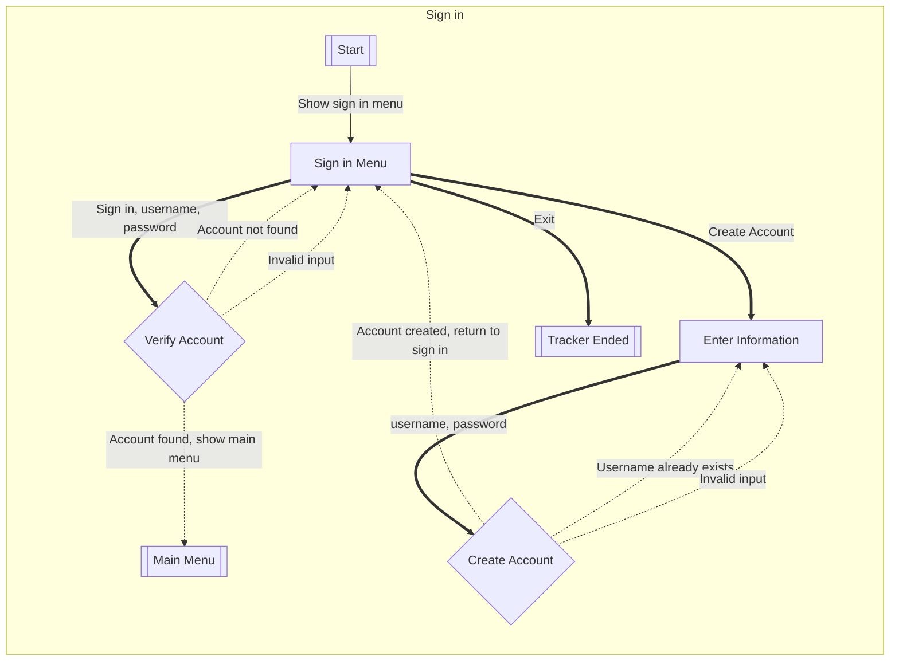
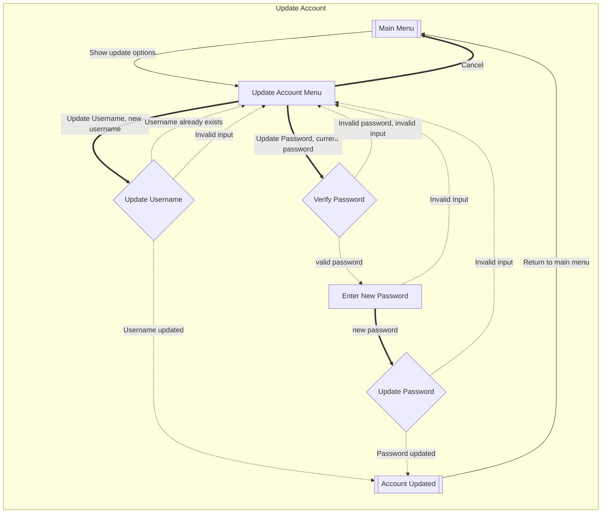
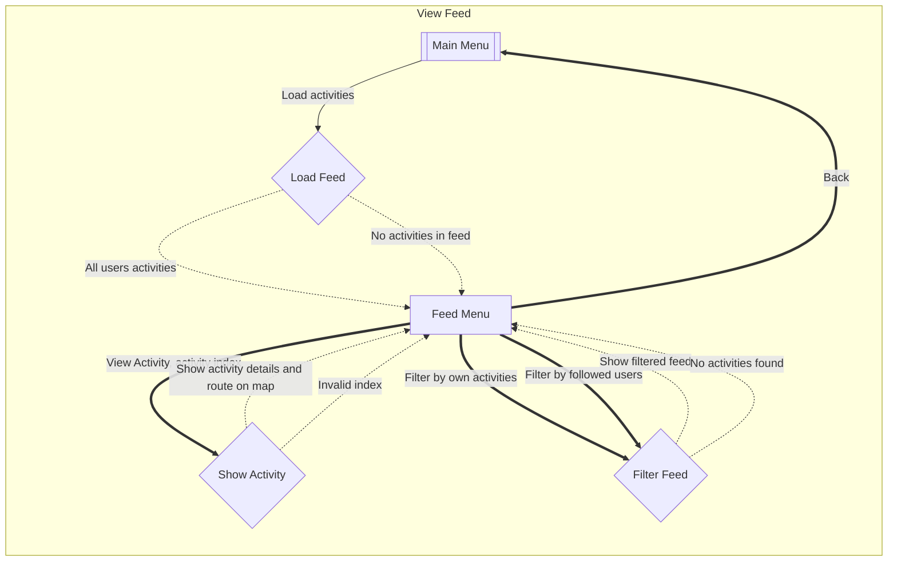
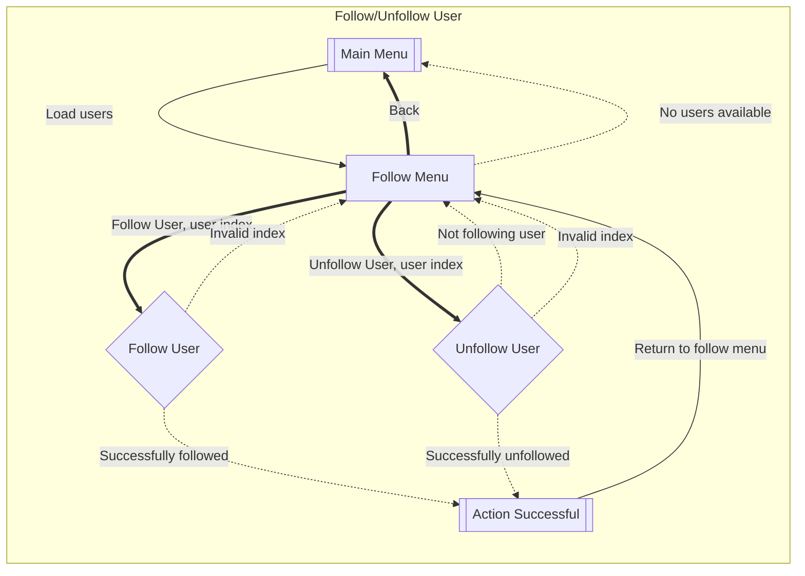
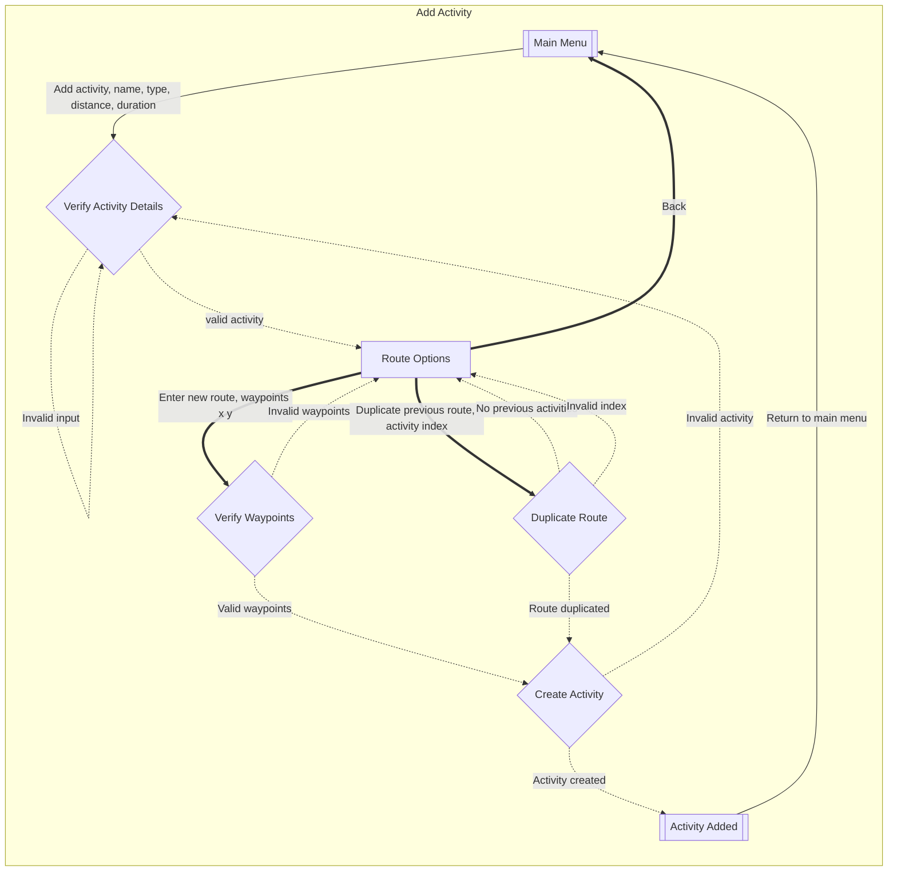
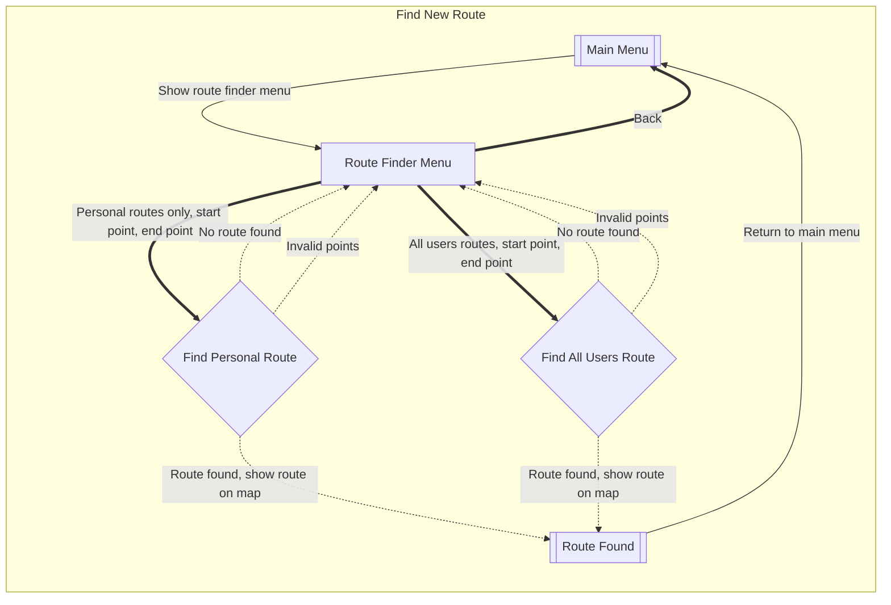
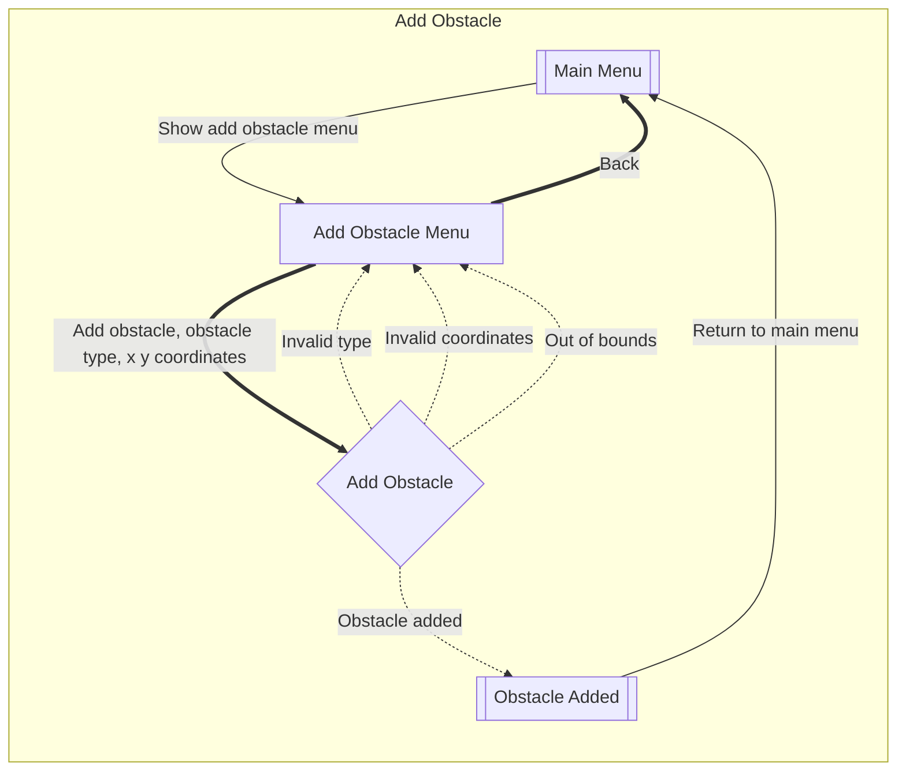
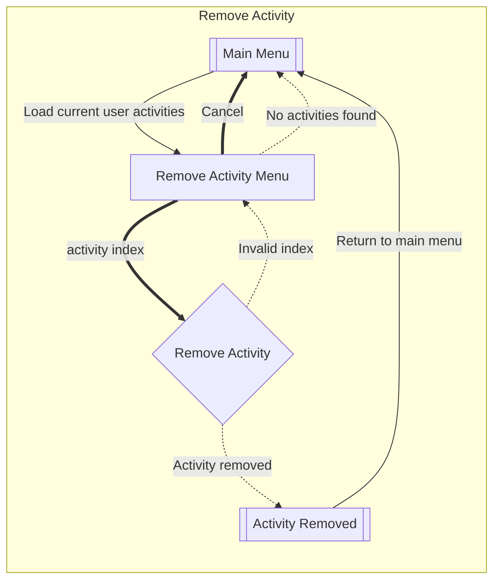
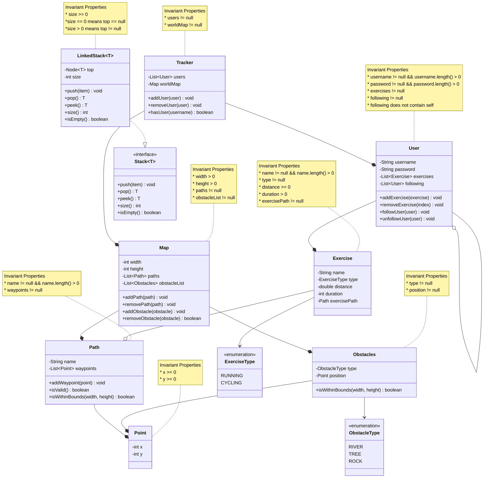

## Overview

> The program features an Exercise Tracker with several options:
>
> The Main Menu is displayed after a successful sign in attempt on a "SIGN IN" menu
> prior where creating a new account is also an option.
> Further the user has options such as "UPDATE ACCOUNT", which allows the user to
> modify their username and password. The user can "VIEW FEED", which shows their own activities
> mixed with activities of all other users on the tracker.
> Users can also choose to "FOLLOW" or "UNFOLLOW" other users of the Exercise Tracker.

> Important features also include "ADD ACTIVITY", "REMOVE ACTIVITY", "ADD OBSTACLE", and
> "FIND NEW ROUTE" which uses a stack based path finding algorithm to find a new route. Route finding
> has two options: finding a route using exclusively the current user's previously taken routes, or
> finding a route using all routes from any user on the tracker.

> When adding an activity, the user can either enter a new route by providing waypoints, or duplicate
> a route from one of their own previous activities.

> The SIGN IN menu also features options like "CREATE ACCOUNT" and "EXIT".

> The map is displayed as a 10x10 grid where each cell is represented by a symbol:
> * `.` represents an empty area with no activity or obstacle present.
> * `>` represents a waypoint of an activity path that has been added to the map.
> * `*` represents an obstacle such as a RIVER, TREE, or ROCK placed on the map.
> * `@` represents a found route returned by the path finding algorithm.

## Testing a stack

| method      | data                                 | expected outcome                                                 |
| ----------- | ------------------------------------ | ---------------------------------------------------------------- |
| `push()`    | empty stack, push `"hello"`          | size() = 1; isEmpty() = false; peek() = "hello"; pop() = "hello" |
| `push()`    | push multiple elements `"A","B","C"` | size() = 3; peek() = "C"                                         |
| `pop()`     | stack with `"A","B","C"`             | returns "C"; size decreases by 1                                 |
| `pop()`     | single element `"A"`                 | returns "A"; stack becomes empty                                 |
| `pop()`     | empty stack                          | throws exception ("empty stack")                                 |
| `peek()`    | stack with `"A","B"`                 | returns "B"; size unchanged                                      |
| `peek()`    | empty stack                          | throws exception                                                 |
| `size()`    | new stack                            | returns 0                                                        |
| `size()`    | after 5 pushes                       | returns 5                                                        |
| `isEmpty()` | new stack                            | returns true                                                     |
| `isEmpty()` | after push                           | returns false                                                    |
| `isEmpty()` | after popping all elements           | returns true                                                     |

## Edge Cases Handling
* Does not let a user update their username to an existing username.
* Does not let a user create an account with an already existing username.
* Does not let a user follow the same user twice.
* Does not let a user add a path outside the map bounds (0-9, 0-9).
* Does not let a user add an obstacle outside the map bounds (0-9, 0-9).
* Does not let a user duplicate a route when they have no previous activities.
* Does not let a user remove an activity with an invalid index.
* Does not let a user enter non-integer values for coordinates or index selections.
* Does not let a user enter empty username or password fields.

## Flows of interaction

### Updates
* Now the map is a 10x10 hard coded grid instead of being accepted as dimensions from the user.
* All menu options are now number-based instead of text-based commands.
* In Update Account, added password verification upon choosing to update password.
* In View Feed, full feed now shows activities from all users on the tracker regardless of following status.
* In Follow/Unfollow, only shows users that are not already being followed in the follow list.
* In Find New Route, feed route now searches through all users' routes on the tracker rather than only followed users.
* In Add Activity, route options menu is now shown after entering activity details rather than as a separate menu step.
* Cancel option added to Remove Activity to allow backing out without removing.

### Resources

* https://code.cs.umanitoba.ca/comp2450-fall2025/2450-stack/-/blob/main/src/main/java/ca/umanitoba/cs/umbrist1/generics/stacks/Stack.java
* https://en.wikipedia.org/wiki/Backtracking
* https://code.cs.umanitoba.ca/comp2450-winter2026/2450-hack
* https://en.wikipedia.org/wiki/Flowchart
* https://mermaid.js.org/syntax/flowchart.html#a-node-in-a-subroutine-shape
* https://mermaid.js.org/syntax/flowchart.html#decision-diamond
* https://mermaid.js.org/syntax/flowchart.html

### Diagrams

### Sign in

### Updating Account

### Viewing Feed

### User Following

### Adding Exercise

### Finding New Route

### Adding Obstacle

### Removing Exercise

## Domain Model

## Changes

#### Removed the Node class and related invariant notes and relationships as Node class is implemented internally in LinkedStack.
#### Added adequate invariant checks for the new classes.
#### Updated relationships accordingly.

## Resources

* https://code.cs.umanitoba.ca/comp2450-winter2026/2450-hack
* https://mermaid.js.org/syntax/classDiagram.html#defining-relationship
* https://mermaid.js.org/syntax/classDiagram.html#annotations-on-classes
* https://en.wikipedia.org/wiki/Read%E2%80%93eval%E2%80%93print_loop
* https://en.wikipedia.org/wiki/ASCII

## Diagram

